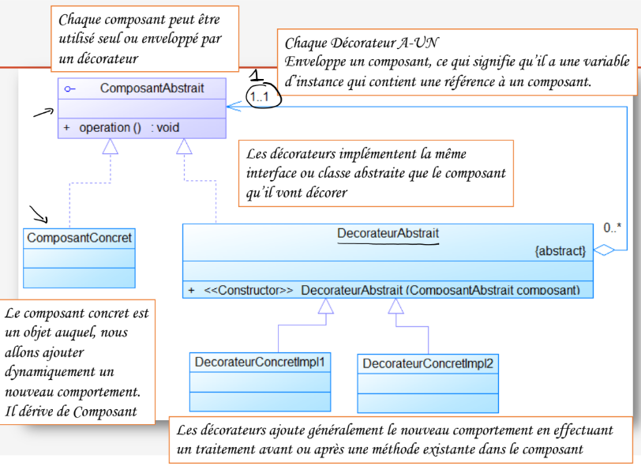
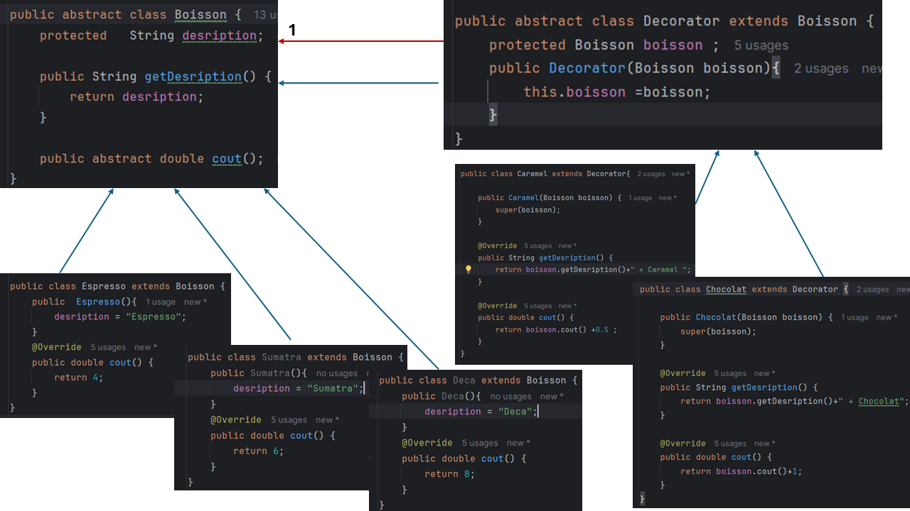
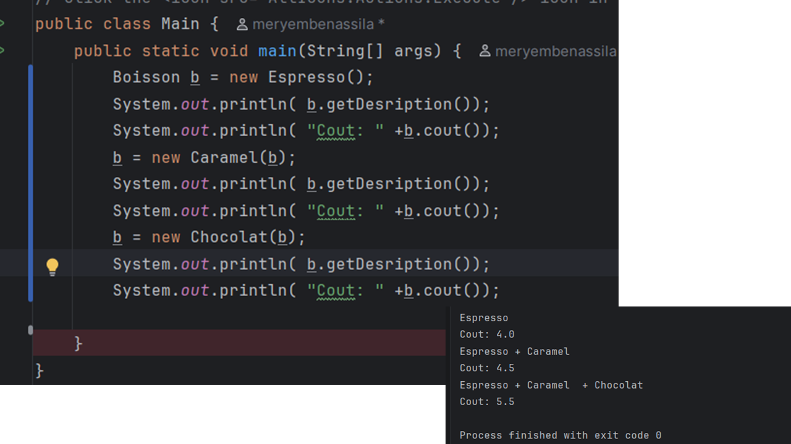

# Design Pattern Decorator

Ce projet met en pratique le **Design Pattern Decorator** en Java. Il permet d’ajouter dynamiquement des fonctionnalités ou des responsabilités à un objet sans modifier sa classe.

## 1. Diagramme de classes

## 2. Implémentation

L’exemple porte sur des boissons (`Espresso`, `Deca`, `Sumatra`) auxquelles on peut ajouter dynamiquement des décorateurs, comme `Chocolat` et `Caramel`.

Chaque décorateur enveloppe une boisson et ajoute son propre coût et sa description, sans modifier la classe de la boisson initiale.

## 3. Test

Le test permet de vérifier la composition des boissons avec différents décorateurs et de constater l’évolution de leur description et de leur coût.

